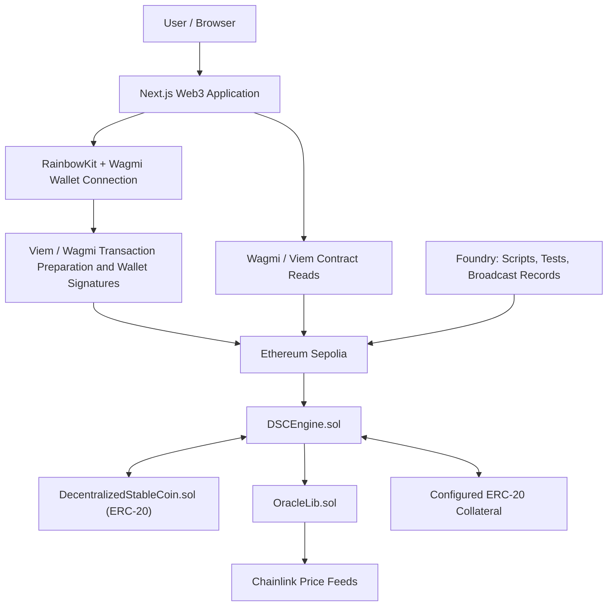

# Decentralized Stablecoin | Full-Stack Web3 dApp

**A hands-on DeFi project connecting Solidity smart contracts to a Next.js frontend on Ethereum Sepolia.**

[](https://github.com/Shivasaiyadav08/Stable-Coin/actions/workflows/test.yml)


**[Live frontend](https://decentralizedstablecoin.vercel.app) · [Frontend source](https://github.com/Shivasaiyadav08/Stable-Coin-frontend) · [DSC token on Sepolia](https://sepolia.etherscan.io/address/0xE9543340546545d8f3ab470d00c809D37f364B7A)**

> **Educational Sepolia testnet prototype.** DSC targets $1 but is not guaranteed to maintain a market peg. This project is not an audited production financial protocol.

## Overview

This project demonstrates the lifecycle of a collateral-backed, USD-targeted stablecoin application: working with Solidity contracts using Foundry, deploying an instance to Sepolia, and building a browser-based frontend for on-chain interactions.

The **core stablecoin contracts are based on Patrick Collins' [Cyfrin Foundry DeFi Stablecoin course project](https://github.com/Cyfrin/foundry-defi-stablecoin-cu)**. I studied and adapted the implementation, deployed my own instance to **Ethereum Sepolia**, and built a **separate Next.js frontend** for interacting with it.

| Repository | Contents |
| --- | --- |
| **[Stable-Coin](https://github.com/Shivasaiyadav08/Stable-Coin)** | Solidity contracts, Foundry scripts and tests, CI, and deployment records |
| **[Stable-Coin-frontend](https://github.com/Shivasaiyadav08/Stable-Coin-frontend)** | Next.js application, wallet connection, collateral and DSC operations, position monitoring, and liquidation interface |

**Portfolio focus:** Solidity and Foundry, Ethereum testnet deployment, ABI-based contract integration, wallet transactions, account queries, and frontend state management.

## My contributions beyond the educational reference

### 1. Deployed my DSC instance on Sepolia

The project's Foundry broadcast records are committed under [`broadcast/`](broadcast/). The recorded deployment uses **Ethereum Sepolia (chain ID 11155111)**.

| Contract | Recorded address |
| --- | --- |
| DSC ERC-20 token | [`0xE9543340546545d8f3ab470d00c809D37f364B7A`](https://sepolia.etherscan.io/address/0xE9543340546545d8f3ab470d00c809D37f364B7A) |
| DSCEngine | [`0xe7346418690ed8e133b145d236dac9a48c8c269c`](https://sepolia.etherscan.io/address/0xe7346418690ed8e133b145d236dac9a48c8c269c) |

These addresses match the current frontend configuration. Check Etherscan for live contract status before sending transactions.

### 2. Built a separate Web3 frontend

The [frontend repository](https://github.com/Shivasaiyadav08/Stable-Coin-frontend) uses **Next.js 15, React, TypeScript, RainbowKit, Wagmi, Viem, TanStack Query, and Tailwind CSS**.

Features represented in the frontend source include:

- **Wallet integration:** Connect an EVM wallet to the configured **Sepolia** network.
- **Collateral management:** Approve supported collateral, deposit, and redeem.
- **DSC operations:** Mint DSC and burn DSC to repay debt.
- **Position monitoring:** Display account balances, debt, collateral value, and health factor.
- **Public account exploration:** Inspect other positions and access liquidation tools where applicable.
- **Transaction handling:** Review, simulation, signatures, receipts, errors, and data refresh.
- **Responsive design:** Public landing page, account dashboard, explorer, and documentation.

The current frontend intentionally supports **Sepolia only**. Running against Anvil requires separate deployment addresses and configuration. A collateral address configured in the deployed engine currently lacks accessible ERC-20 metadata on Sepolia; the frontend excludes it rather than displaying invented token information. See the [frontend README](https://github.com/Shivasaiyadav08/Stable-Coin-frontend#readme) for details.

### 3. Integrated contract reads and writes

The frontend connects to the deployed engine through these current files:

- [`src/lib/contracts.ts`](https://github.com/Shivasaiyadav08/Stable-Coin-frontend/blob/main/src/lib/contracts.ts) — chain, deployment addresses, and contract ABI.
- [`src/hooks/useProtocol.ts`](https://github.com/Shivasaiyadav08/Stable-Coin-frontend/blob/main/src/hooks/useProtocol.ts) — protocol and account queries.
- [`src/hooks/useManagePosition.ts`](https://github.com/Shivasaiyadav08/Stable-Coin-frontend/blob/main/src/hooks/useManagePosition.ts) — amount validation, position preview, and action preparation.
- [`src/components/ManagePosition.tsx`](https://github.com/Shivasaiyadav08/Stable-Coin-frontend/blob/main/src/components/ManagePosition.tsx) — deposit, mint, burn, and redeem interface.
- [`src/lib/transactions.ts`](https://github.com/Shivasaiyadav08/Stable-Coin-frontend/blob/main/src/lib/transactions.ts) — token approvals, simulation, wallet signatures, and receipt tracking.
- [`src/components/LiquidationForm.tsx`](https://github.com/Shivasaiyadav08/Stable-Coin-frontend/blob/main/src/components/LiquidationForm.tsx) — liquidation transaction interface.

These integrations and my deployment work are the main extensions demonstrated beyond the smart-contract-focused educational source.

## Architecture



## Protocol mechanics

The stablecoin mechanism is built around collateral deposits, DSC issuance and repayment, oracle-based valuation, and liquidation of positions that fail the health-factor check.

1. **Deposit:** Approve and transfer a supported ERC-20 collateral asset into `DSCEngine`.
2. **Mint:** Issue DSC only while the resulting health factor satisfies the engine requirement.
3. **Monitor:** Read collateral, debt, and health factor from the contracts.
4. **Repay and redeem:** Burn DSC to repay debt, then redeem collateral within the contract rules.
5. **Liquidate:** Eligible unhealthy positions may be liquidated by covering debt in return for collateral plus the contract's liquidation bonus.

### Collateralization

The reviewed engine defines a **50% liquidation threshold**, corresponding to **200% minimum collateralization** at oracle-reported prices, a **minimum health factor of 1.0**, and a **10% liquidation bonus**.

```text
Health factor = (collateral value in USD × 50%) / outstanding DSC debt
```

Positions with outstanding debt and a health factor below `1.0` may be liquidated subject to contract checks. **The intended $1 DSC peg is not a guarantee of market value.**

## Tech stack

| Layer | Technology |
| --- | --- |
| Blockchain | Ethereum Sepolia; Anvil for local contract development |
| Smart contracts | Solidity, OpenZeppelin |
| Oracles | Chainlink price feeds |
| Development and testing | Foundry: Forge, Cast, Anvil |
| Frontend | Next.js 15, React, TypeScript |
| Wallet connectivity | RainbowKit, Wagmi |
| Blockchain client | Viem |
| Client-side queries | TanStack Query |
| Styling | Tailwind CSS |
| Automation | GitHub Actions |

## Repository guide

```text
Stable-Coin/
├── .github/workflows/test.yml
├── src/
│   ├── DSCEngine.sol
│   ├── DecentralizedStableCoin.sol
│   └── libraries/OracleLib.sol
├── script/
│   ├── DeployDSC.s.sol
│   └── HeplerConfig.s.sol
├── test/
├── broadcast/
├── foundry.toml
├── makefile
└── README.md
```

> The UI is maintained separately in **[Stable-Coin-frontend](https://github.com/Shivasaiyadav08/Stable-Coin-frontend)**.

## Run the smart-contract project

Install [Git](https://git-scm.com/) and [Foundry](https://getfoundry.sh/), then run:

```bash
git clone --recurse-submodules https://github.com/Shivasaiyadav08/Stable-Coin.git
cd Stable-Coin
forge build
forge fmt --check
forge test -vvv
```

To start a local EVM node in a separate terminal:

```bash
anvil
```

Deployment scripts live under [`script/`](script/). Use an appropriate RPC and signing configuration when deploying. **Never commit wallet private keys, seed phrases, or production credentials.**

## Run the frontend

Use **Node.js 24** and npm:

```bash
git clone https://github.com/Shivasaiyadav08/Stable-Coin-frontend.git
cd Stable-Coin-frontend
npm ci
npm run dev
```

Open [http://localhost:3000](http://localhost:3000). The frontend uses Sepolia, and injected browser wallets can work without a WalletConnect project ID.

For WalletConnect / QR wallet connections, copy [`.env.example`](https://github.com/Shivasaiyadav08/Stable-Coin-frontend/blob/main/.env.example) to `.env.local` and configure:

```dotenv
NEXT_PUBLIC_WALLETCONNECT_PROJECT_ID=
NEXT_PUBLIC_SEPOLIA_RPC_URL=
```

`NEXT_PUBLIC_SEPOLIA_RPC_URL` is optional; the public RPC is used by default. `NEXT_PUBLIC_` environment variables are exposed to the browser, so do not place secrets in them. For details, see the [frontend setup guide](https://github.com/Shivasaiyadav08/Stable-Coin-frontend#local-setup).

## What I learned

- Understanding ERC-20 interactions, price feeds, collateralization, and account health.
- Using Foundry to compile and test Solidity contracts.
- Deploying an educational protocol instance to a public Ethereum testnet.
- Reading contract state and preparing wallet transactions through a typed frontend.
- Handling allowances, transaction confirmation, rejected signatures, and UI state.
- Maintaining smart contracts and the frontend in separate, linked repositories.

## Attribution

The **core protocol design and educational implementation** originate from **Patrick Collins / Cyfrin**:

**[Cyfrin — Foundry DeFi Stablecoin Course Repository](https://github.com/Cyfrin/foundry-defi-stablecoin-cu)**

This portfolio project builds on that educational foundation. My demonstrated extensions include the separate Web3 frontend, wallet-connected integration, interface flows, and deployment of my Sepolia instance. The course also includes deployment examples; I do not claim to have invented the stablecoin mechanism or testnet-deployment process.

## Author

**[Shiva Sai](https://github.com/Shivasaiyadav08)**

[Smart contracts](https://github.com/Shivasaiyadav08/Stable-Coin) · [Frontend repository](https://github.com/Shivasaiyadav08/Stable-Coin-frontend) · [Live frontend](https://decentralizedstablecoin.vercel.app)

---

*Educational Web3 project and Sepolia testnet prototype.*
