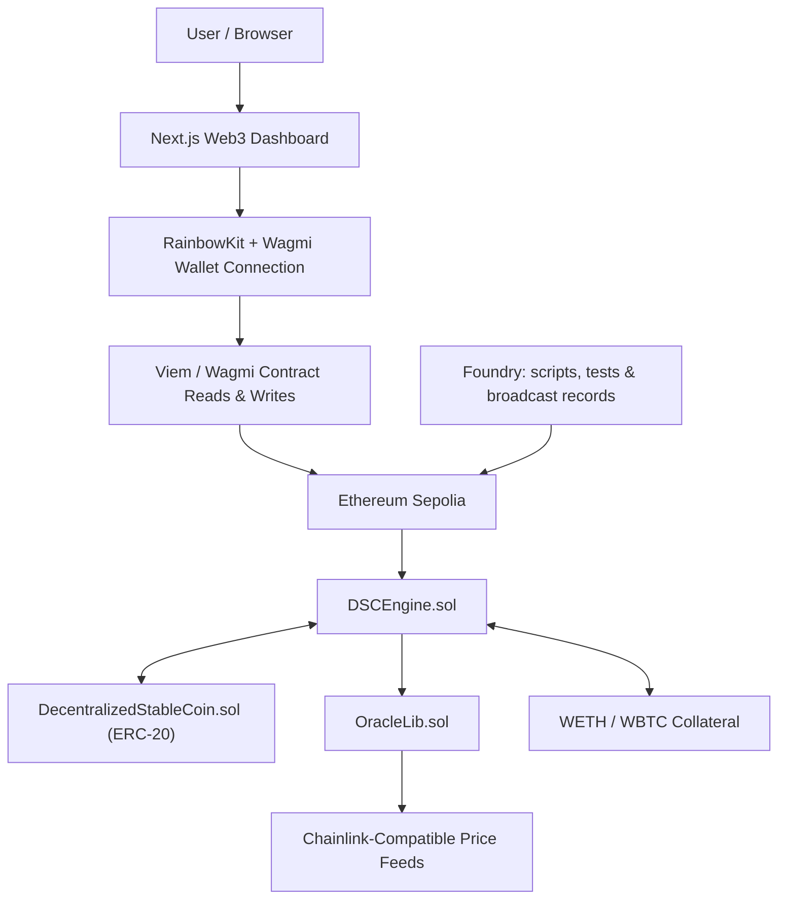

# Decentralized Stablecoin | Full-Stack Web3 dApp

**A hands-on DeFi project connecting Solidity smart contracts to an interactive frontend on Ethereum Sepolia.**

[](https://github.com/Shivasaiyadav08/Stable-Coin/actions/workflows/test.yml)


**[Smart Contracts](https://github.com/Shivasaiyadav08/Stable-Coin) · [Web3 Frontend](https://github.com/Shivasaiyadav08/Stable-Coin-frontend) · [DSC on Sepolia Etherscan](https://sepolia.etherscan.io/address/0xE9543340546545d8f3ab470d00c809D37f364B7A)**

## Overview

This project explores the complete lifecycle of a collateral-backed, USD-targeted stablecoin dApp—from writing and testing Solidity contracts with Foundry to deploying them on Sepolia and connecting them to a browser-based application.

The **core decentralized stablecoin contracts are based on Patrick Collins' [Cyfrin Foundry DeFi Stablecoin course project](https://github.com/Cyfrin/foundry-defi-stablecoin-cu)**. I studied and adapted that implementation, deployed my own instance on **Ethereum Sepolia**, and built a **separate Next.js frontend** that exposes wallet-connected interactions with the deployed contracts.

The code is organized into two repositories:

| Repository | What it contains |
| --- | --- |
| **[Stable-Coin](https://github.com/Shivasaiyadav08/Stable-Coin)** | Solidity contracts, Foundry scripts, tests, configuration, CI and Sepolia deployment records |
| **[Stable-Coin-frontend](https://github.com/Shivasaiyadav08/Stable-Coin-frontend)** | Next.js/React user interface, wallet connection, contract integrations, position monitoring and transaction forms |

**Portfolio focus:** Solidity and Foundry fundamentals, practical Ethereum testnet deployment, contract ABI integration, wallet connections, on-chain reads/writes, and frontend state management.

## My contributions beyond the reference project

Rather than claim the original stablecoin mechanism as my own, this section highlights the integration and application development work represented in my repositories.

### 1. Deployed my own DSC instance to Sepolia

Configured and broadcasted a deployment on **Ethereum Sepolia (chain ID 11155111)**, with a Foundry deployment record committed in [`broadcast/`](broadcast/).

| Contract | Recorded address |
| --- | --- |
| DSC ERC-20 token | [`0xE9543340546545d8f3ab470d00c809D37f364B7A`](https://sepolia.etherscan.io/address/0xE9543340546545d8f3ab470d00c809D37f364B7A) |
| DSCEngine | [`0xe7346418690ed8e133b145d236dac9a48c8c269c`](https://sepolia.etherscan.io/address/0xe7346418690ed8e133b145d236dac9a48c8c269c) |

These addresses come from the project's deployment record. Check Etherscan for current on-chain details.

### 2. Built a separate Web3 frontend

Developed a **Next.js 15 / React / TypeScript** interface, using **RainbowKit**, **Wagmi**, **Viem**, **TanStack Query**, and **Tailwind CSS**, to interact with the DSC protocol through a connected wallet.

The frontend repository contains:

- **Wallet connection and supported networks:** RainbowKit configuration for Sepolia and local Anvil.
- **Collateral controls:** Token approval and deposit transactions, plus collateral redemption.
- **DSC lifecycle controls:** Minting and burning transactions against DSCEngine.
- **Account monitoring:** Contract reads for health factor, account information and protocol parameters.
- **Liquidation tooling:** Health-factor lookup for an account and a form for initiating liquidation.
- **Transaction state:** Validation, loading feedback, wallet writes and refreshes of contract data.
- **Responsive dashboard layout:** Separate account, user, protocol-action and liquidation components.

**[Explore the frontend source →](https://github.com/Shivasaiyadav08/Stable-Coin-frontend)**

### 3. Connected contract execution to the UI

The frontend integrates deployed contract addresses and ABIs with custom hooks:

- [`useDscEngine.ts`](https://github.com/Shivasaiyadav08/Stable-Coin-frontend/blob/main/src/hooks/useDscEngine.ts) — reads contract state and account metrics.
- [`useTokenOperations.ts`](https://github.com/Shivasaiyadav08/Stable-Coin-frontend/blob/main/src/hooks/useTokenOperations.ts) — approval and write-transaction helpers.
- [`DscActions.tsx`](https://github.com/Shivasaiyadav08/Stable-Coin-frontend/blob/main/src/components/DscActions.tsx) — collateral deposit/redeem and DSC mint/burn actions.
- [`Liquidate.tsx`](https://github.com/Shivasaiyadav08/Stable-Coin-frontend/blob/main/src/components/Liquidate.tsx) — health checks and liquidation interaction.

This is the project's main extension beyond the original **smart-contract-focused educational reference**.

## Architecture



## Protocol mechanics

The underlying stablecoin is designed around collateral deposits, DSC issuance and repayment, oracle-based valuation, and liquidation of insufficiently collateralized positions.

1. **Deposit:** A user approves and transfers supported WETH or WBTC collateral to `DSCEngine`.
2. **Mint:** The engine permits DSC minting only if the account's resulting health factor is sufficient.
3. **Monitor:** Account information and collateral valuations can be read from the contracts.
4. **Repay and redeem:** Users burn DSC to reduce debt and redeem collateral within health-factor constraints.
5. **Liquidate:** An unhealthy position can be liquidated through debt repayment in return for collateral and a calculated bonus.

### Collateralization

The engine uses a **50% liquidation threshold**, equivalent to a **200% minimum collateralization requirement** at the oracle-reported asset prices.

```text
Health factor = (collateral value in USD × 50%) / outstanding DSC debt
```

A health factor below `1.0` is liquidatable. The protocol calculates a **10% liquidation bonus** on the collateral corresponding to covered debt.

**DSC's $1 value is a design target, not a guaranteed market price.**

## Tech stack

| Layer | Technology |
| --- | --- |
| Blockchain | Ethereum Sepolia, local Anvil |
| Smart contracts | Solidity, OpenZeppelin |
| Oracles | Chainlink-compatible price feeds |
| Development and testing | Foundry: Forge, Cast, Anvil |
| Frontend | Next.js 15, React, TypeScript |
| Wallet connectivity | RainbowKit, Wagmi |
| Blockchain client | Viem |
| Client-side data | TanStack Query |
| Styling | Tailwind CSS |
| Automation | GitHub Actions |

## Repository guide

```text
Stable-Coin/
├── .github/workflows/test.yml
├── src/
│   ├── DSCEngine.sol
│   ├── DecentralizedStableCoin.sol
│   └── libraries/OracleLib.sol
├── script/
│   ├── DeployDSC.s.sol
│   └── HeplerConfig.s.sol
├── test/
│   ├── DSCEngineTest.t.sol
│   ├── fuzz/
│   └── mocks/
├── broadcast/
│   └── DeployDSC.s.sol/11155111/
├── foundry.toml
├── makefile
└── README.md
```

> The UI is **not** contained in this repository. Find it in **[Stable-Coin-frontend](https://github.com/Shivasaiyadav08/Stable-Coin-frontend)**.

## Run the smart-contract project

Install [Git](https://git-scm.com/) and [Foundry](https://getfoundry.sh/) first.

```bash
git clone --recurse-submodules https://github.com/Shivasaiyadav08/Stable-Coin.git
cd Stable-Coin

forge build
forge fmt --check
forge test -vvv
```

Start a local EVM development node, if needed:

```bash
anvil
```

The deployment script is [`script/DeployDSC.s.sol`](script/DeployDSC.s.sol). Use an appropriate local or Sepolia signing account and RPC configuration when broadcasting transactions. Never commit actual wallet private keys.

## Run the frontend

```bash
git clone https://github.com/Shivasaiyadav08/Stable-Coin-frontend.git
cd Stable-Coin-frontend
npm ci
```

Create `.env.local` and configure a WalletConnect project ID:

```dotenv
NEXT_PUBLIC_WALLETCONNECT_PROJECT_ID=your_walletconnect_project_id
```

Start the development server:

```bash
npm run dev
```

Open [http://localhost:3000](http://localhost:3000), connect a compatible wallet and select **Sepolia**. The frontend source contains the network/provider configuration and contract addresses in [`src/constants.ts`](https://github.com/Shivasaiyadav08/Stable-Coin-frontend/blob/main/src/constants.ts).

## What I learned

This project helped me translate smart-contract coursework into an application integration workflow:

- Reading and working with ERC-20 and collateral-management contracts.
- Understanding price feeds, overcollateralization and account health.
- Running Foundry compilation and contract tests.
- Managing an EVM deployment outside the local development environment.
- Connecting React components to on-chain data using ABI-based reads.
- Handling token allowances, wallet transactions and UI state.
- Splitting the protocol and frontend into separately maintained repositories.

## Attribution

The **core contract design and course implementation** originated from **Patrick Collins / Cyfrin**:

**[Cyfrin — Foundry DeFi Stablecoin Course Repository](https://github.com/Cyfrin/foundry-defi-stablecoin-cu)**

This portfolio project builds upon that educational foundation. My demonstrated extensions are the **separate Web3 frontend, wallet-connected UI flows, contract integration and my own Sepolia deployment**. The course reference also documents testnet deployment, so the contribution is my practical deployment and integration work—not an invented new stablecoin algorithm.

## Author

**[Shiva Sai](https://github.com/Shivasaiyadav08)**

[Smart Contracts](https://github.com/Shivasaiyadav08/Stable-Coin) · [Frontend](https://github.com/Shivasaiyadav08/Stable-Coin-frontend)

---

*Educational Web3 project and Sepolia testnet prototype.*
